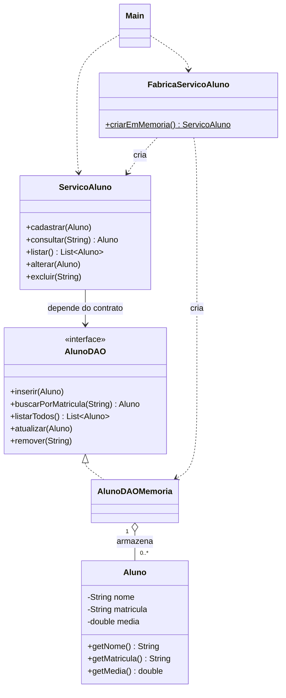

# Aula 8 — CRUD completo e consolidação da Etapa 1

## Correções e responsabilidades

- Aluno é a entidade imutável original: matrícula, nome e média.
- AlunoDAO define operações de persistência com termos do domínio.
- AlunoDAOMemoria implementa cadastro, busca, listagem, atualização e exclusão.
  Cadastro duplicado, atualização ausente e exclusão ausente lançam
  IllegalStateException. Uma busca sem resultado retorna null no DAO.
- A listagem devolve uma nova lista; alterá-la não muda o armazenamento.
  Como Aluno é imutável, compartilhar seus elementos não expõe alterações.
- ServicoAluno depende de AlunoDAO por injeção. Consultar, alterar e excluir
  sinalizam matrícula ausente. O método privado validar é reutilizado no
  cadastro e na alteração: nome e matrícula obrigatórios, média finita entre
  0 e 10, incluindo os limites. NaN e infinitos também são recusados.
- Main usa o serviço, mostra sucesso somente após concluir a operação e
  traduz exceções em mensagens específicas. Não repete regras do domínio.

O código inicial expunha a lista, removia registros ausentes silenciosamente
e validava a média em duas camadas com limites divergentes. Os três problemas
foram corrigidos. Os dados permanecem apenas durante a execução; não há banco
de dados ou persistência em disco nesta implementação.

## Modelo e decisões da Etapa 1

O modelo disponível contém uma entidade Aluno, identificada pela matrícula.
Alterar um aluno substitui a instância armazenada, mantendo sua matrícula.
Não há requisitos fornecidos para outras entidades ou relacionamentos.

FabricaServicoAluno aplica uma **fábrica simples** para centralizar a montagem
de um serviço com um novo DAO em memória. Cada chamada produz armazenamento
independente. Essa técnica criacional separa a escolha da implementação da
apresentação; não é uma implementação do padrão GoF Factory Method.
O serviço continua aceitando qualquer implementação de AlunoDAO, permitindo
trocar a persistência sem modificar suas regras. A fábrica é um ponto único
de composição, sem necessidade de estado global ou Singleton.



A Seção 10 da apostila mencionada na atividade não acompanha os arquivos.
Esta documentação cobre o modelo e as decisões do SIGA fornecido; a aderência
a requisitos adicionais do Projeto Integrador não foi verificada.
O PDF denominado guia de resolução veio com uma única página em branco;
foram usados o README inicial, a ficha da atividade e os fontes.

## Compilar, executar e testar

Pré-requisito: JDK 17 ou superior. Em PowerShell, dentro de aula08:

```powershell
New-Item -ItemType Directory -Force bin | Out-Null
javac -encoding UTF-8 --release 17 -d bin src/siga/*.java
java -cp bin siga.Main
javac -encoding UTF-8 --release 17 -cp bin -d bin tests/siga/TestesSiga.java
java -cp bin siga.TestesSiga
```

O teste executável cobre CRUD no DAO e no serviço, matrícula duplicada,
registros ausentes, cópia defensiva, dados inválidos, limites, médias não
finitas, isolamento dos serviços criados e mensagens da apresentação.
As saídas reais estão em [evidencias/execucao.txt](evidencias/execucao.txt)
e [evidencias/testes.txt](evidencias/testes.txt).

## Uso de IA

Esta versão recebeu apoio de IA na implementação, documentação e testes.
Aluno e AlunoDAO foram preservados. A ficha da atividade proíbe geração de
código por IA por padrão. Esta declaração registra o uso ocorrido e não
modifica as regras da disciplina.
